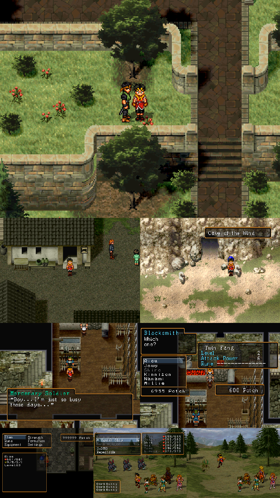

# Suikoden II: Rebalanced v1.2

A combat rebalance for the original USA PlayStation release, by RetchERezzed

**[Download v1.2](https://github.com/RetchERez/Suikoden-II-Rebalanced/releases/download/v1.2/Suikoden-II-Rebalanced-v1.2.zip)** · [Installation](README.txt) · [Every change](README_EVERY_CHANGE.txt) · [Compatibility](COMPATIBILITY.md)

## New in v1.2

- Removes Clive's elapsed-playtime deadlines at Lakewest, Forest Village, Rockaxe, Radat and Sajah
- Keeps the normal game clock running and preserves all existing combat, spelling and Potch changes
- Retains story access, recruitment prerequisites and one-time quest flags; already failed saves are not automatically reset

The Clive change applies to eligible existing saves. You must still see the initial Muse encounter and satisfy the quest's other prerequisites

## Included rebalance

- Selected growth improvements for 22 characters and earlier head rune slots for Tuta, Millie, Hai Yo and Hoi
- Repeatable Trick, Groundhog and Spider Slay, with adjusted damage coefficients
- Damage adjustments for Mayfly and Swallow, and coefficient increases for 14 Unite families
- The standalone penalty-preserving negative-Kindness repair, two Headquarters preload repairs, corrected Mercenary Soldier labels, reviewed spelling, rune help and Potch formatting

## Install and saves

Use your own legally sourced, untouched USA **SLUS-00958** single-track **MODE2/2352 BIN/CUE** matching [README.txt](README.txt). Apply v1.2 to the clean original, including when upgrading from v1.0 or v1.1; use a new output BIN and copied CUE

The ZIP contains exactly the xdelta patch, README.txt and README_EVERY_CHANGE.txt. No ROM, BIOS, emulator or save is supplied

Vanilla saves retain their growth/rune-slot table and already earned stats. A new game is recommended for the complete rebalance. Correctly migrated older Rebalanced saves need no further table migration. Restart the emulator and use normal saves rather than old emulator states

## Verification and limits

All previous 1280 guarded edits remain unchanged. The five new deadline instructions alter 10 payload bytes plus 220 CD-checksum bytes across five sectors; every other raw sector and the disc layout match v1.1. Deterministic encoding and an exact decode round-trip are verified

Controlled Linux MIPS tests execute all five actual callbacks with only the allocator stubbed. 40 retail calibration cases and 340 candidate time cases check deadlines, late acceptance, clock/story guards and the callback ABI. These are separate from PS1 gameplay

Native Linux PCSX-Redux compared the same normally prepared downloaded save after 15 hours: v1.1 rejected Radat's deadline and v1.2 allowed the event to progress. A normal post-event save was cold-loaded on v1.2 and retained quest progress. This is a save-based Radat comparison, not a full Clive campaign playthrough

Earlier v1.1 evidence covers selected battles, a 108-star Suikoden I import with profile preservation, and the Gremio/Tir Banner intro. The remaining Tir quest, full campaign, every legal loadout/Unite variant, endings and real hardware remain unverified

## Screenshots

The [16-photo gallery](media/README.md) and photos-only eight-picture 9:16 collage were captured on v1.1, using Linux and normal controller input. Those combat/menu settings are unchanged in v1.2. Later locations may contain spoilers; the gallery is not a v1.2 Clive playthrough

## Optional external bug-fix pack

Rebalanced bundles only its existing standalone Kindness repair from Pyriel, not the complete GS2 Bug Fix Patch. The [per-file compatibility audit](COMPATIBILITY.md) confirms default upstream composition preserves our edits; a combined rebuilt image has not been emulated

Apply **clean original → Rebalanced → upstream bugfix tool**, keeping Kindness set to **Penalty**. The **No Penalty** option intentionally overrides that behavior. Our clean-source xdelta does not accept an already bugfix-patched image

## Credits and feedback

Rebalance by RetchERezzed; the existing Kindness repair uses [Pyriel's isolated signed-penalty fix](https://github.com/pyriell/gs2-bugfixes). Additional thanks: Cloudstrife7894, Dyne

For a bug report include emulator/version, location, party and levels, equipment, runes, save origin, patched BIN hash and reproduction steps

Earlier releases remain available. See [CHANGELOG.md](CHANGELOG.md) for version history
