# Screenshot gallery

16 genuine photos of menus, battles, dialogue, and locations, plus an eight-picture 9:16 portrait collage

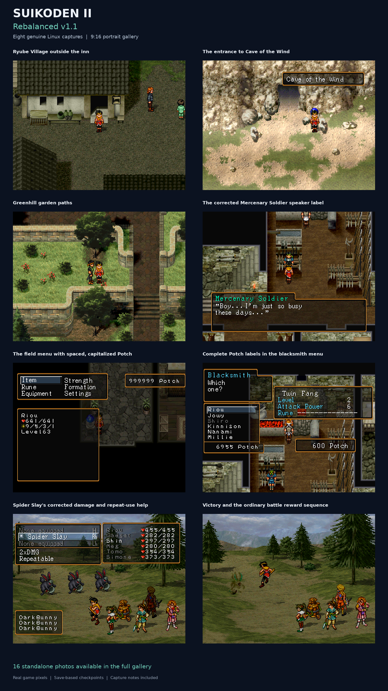

**Ryube Village outside the inn**

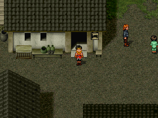

**Exploring the mossy steps of Sindar Ruins**

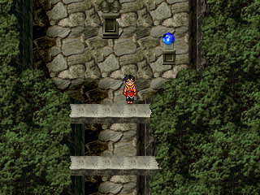

**A city street outside the inn**

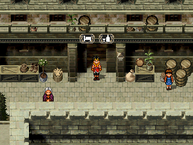

**The entrance to Cave of the Wind**

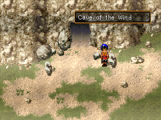

**Kuskus waterfront and stone bridge**

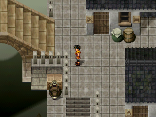

**Outside the stone inn in Crom**

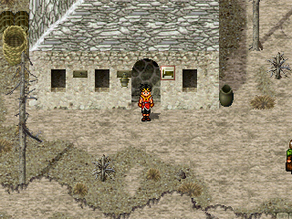

**Greenhill garden paths**

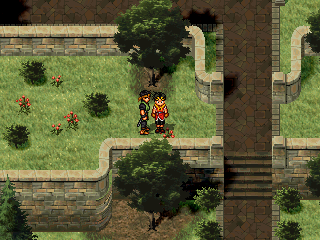

**Inside L'Renouille Castle**

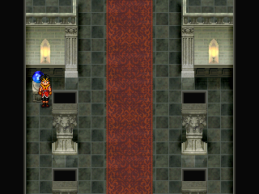

**The corrected Mercenary Soldier speaker label**

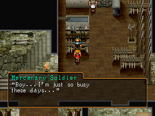

**Apple reports Shu's promise at Headquarters**

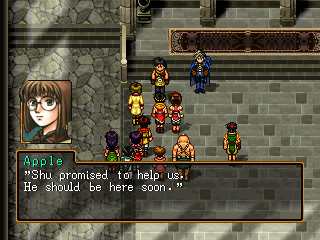

**Inspecting Riou's equipment in Sindar Ruins**

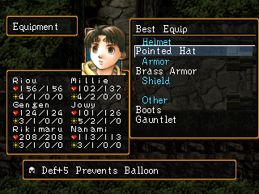

**The field menu with spaced, capitalized Potch**

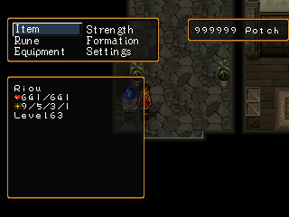

**Complete Potch labels in the blacksmith menu**

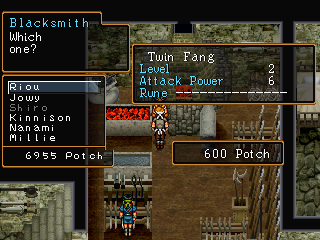

**Spider Slay's corrected damage and repeat-use help**

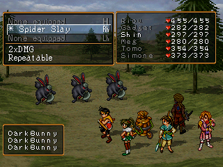

**Tuta after automatic Medicine healing**

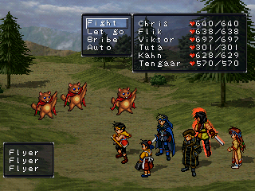

**Victory and the ordinary battle reward sequence**

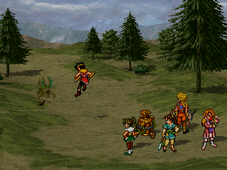

[Capture notes](CAPTURE_NOTES.txt) · [Provenance and hashes](PROVENANCE.json)

Save-based checkpoint visits, with possible spoilers; not an uninterrupted campaign certification
